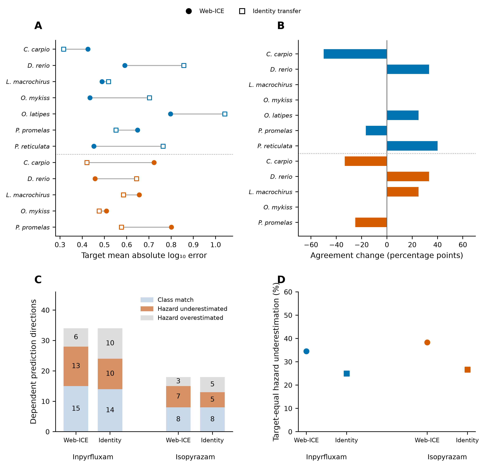

# Interspecies aquatic toxicity extrapolation reliability

Research reproducibility archive for **Reliability and Limitations of Interspecies Aquatic Toxicity Extrapolation: Evidence from Inpyrfluxam and Other Succinate Dehydrogenase Inhibitor Fungicides**.
Authors: Yi Hu; Jiayao Li; Yiheng Jia; Jiran Li; Zesen Li.
Associated manuscript: unpublished; no article DOI or acceptance is claimed.
Public archive version: **1.0.2-public.1**, based on the validated IEAM v1.0.2
anonymous data/code attachment (whose historic filename ends in v1.0.1).

## Project overview and study design

This study evaluates Web-ICE predictions against measured fish 96-h LC50 values
for succinate dehydrogenase inhibitor fungicides and asks whether improved
continuous prediction accuracy leads to more reliable acute hazard classification.

- Inpyrfluxam: 7 freshwater fish endpoints and 34 prediction directions.
- Isopyrazam: 5 fish endpoints and 18 directions.
- Six training-overlap SDHIs: 38 conditional internal directions, reported separately.
- Total: 90 **dependent** directions sharing 30 species–compound endpoints.

The two external validation candidates were absent from the inspected public
paired-training snapshot; full trial-level independence could not be established.
Directions sharing measured endpoints are not independent experimental samples.

## Main findings and interpretation

Web-ICE and direct surrogate transfer do not perform consistently across the two
external candidates. For inpyrfluxam, median fold error was 3.00 versus 5.64, but
class disagreements were 19/34 versus 20/34, with no reduction in category hazard
underestimation. Isopyrazam showed median fold errors of 4.87 versus 2.74 and
10/18 class disagreements under either method. Reported experimental intervals
qualified interpretation; inpyrfluxam target intervals were unavailable.
Improvement in a continuous metric does not necessarily improve a classification
decision. These bounded cases do not establish a universal SDHI rule or quantify
environmental risk without exposure information.

## Repository contents

| Directory/file | Contents and use |
| --- | --- |
| data_and_code/inputs/phase1e | Frozen 90-direction results, overlap/coverage and exploratory surrogate summaries |
| data_and_code/inputs/phase1g_b_source | Saved predictions and curated trial evidence for statistical reproduction |
| data_and_code/inputs/phase1g_b | Frozen 12-table statistical outputs and validation records |
| data_and_code/inputs/phase1g_c | Existing candidate-qualification summary, not new validation predictions |
| data_and_code/config | Frozen analysis plan and surrogate-rule metadata |
| data_and_code/scripts | Validated comparator, six regression tests and existing plotting code |
| data_and_code/legacy_scripts | Frozen standard-library statistical analysis implementation |
| supplementary/tables | Curated endpoint facts, provenance, result tables and structural-context summaries |
| figures | Frozen Fig. 1–3 and Fig. S1–S2 in PDF, PNG and SVG |
| data_and_code/DATA_DICTIONARY.md | Field definitions and units |
| provenance | Source/rights documentation and SHA-256 checksums |
| docs | Reproduction guide, methodological limits and data-availability context |

Original relative paths are retained so archived scripts can run without formula
changes. Some tables intentionally duplicate the frozen supplementary copies.

## Reproduce

```bash
git clone https://github.com/HU18164053837-ai/inpyrfluxam-sdhi-ice-reliability.git
cd inpyrfluxam-sdhi-ice-reliability
python -m pip install -r requirements.txt
python data_and_code/scripts/test_reproduce_review.py
python data_and_code/scripts/reproduce_review.py
```

For checksums and plotting commands (tested in a disposable clean copy), see the
[reproduction guide](docs/reproduction_guide.md). Statistical reproduction requires
only Python's standard library. Frozen figures should be preserved; plotting can
overwrite their rendered copies. See [data dictionary](data_and_code/DATA_DICTIONARY.md).



## Provenance, access and rights

The archive contains author-derived results and limited attributed factual
extractions from public regulatory summaries, including EPA, APVMA and HSE.
It does not include original experimental reports, publisher full texts/SI,
Web-ICE training workbooks, molecular coordinates or software runtimes. Consult
[source index](provenance/source_index.csv), [rights and licences](provenance/rights_and_licenses.md),
and [methodological scope](docs/methodological_scope.md).
Saved statistics can be recomputed; historical Web-ICE fitting/prediction cannot
be reconstructed here without legally obtaining original model assets.

**Public access does not assign a blanket open licence.** Author-created material
has retained rights; third-party permissions remain source-specific. See LICENSE.
Historical frozen documents saying the archive was local describe the editorial
stage and are retained for provenance. This public repository identifies authors;
it must not replace the anonymous review ZIP or be inserted automatically into
anonymous manuscript/SI files. No journal files were modified by publication.

## Citation

Hu, Y., Li, J., Jia, Y., Li, J., and Li, Z. Reliability and Limitations of Interspecies Aquatic Toxicity Extrapolation: Evidence from Inpyrfluxam and Other Succinate Dehydrogenase Inhibitor Fungicides.
Unpublished manuscript; accompanying research code/data archive, version
1.0.2-public.1. Cite the repository URL and exact commit used. CITATION.cff provides
structured archive metadata. Update it only when genuine publication details exist.
